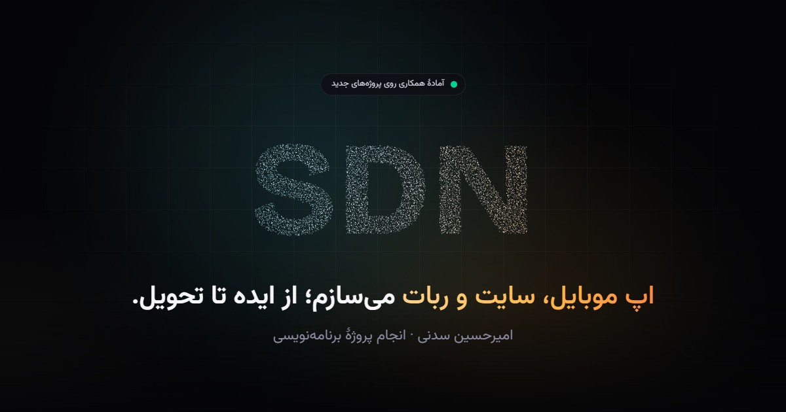

# SDN — Amirhossein Sadani's portfolio

[](https://github.com/Mr-sdn/Mr-sdn.github.io/actions/workflows/deploy.yml)

**Live:** https://mr-sdn.github.io · [فارسی](#فارسی)



My personal site: a bilingual (Persian RTL / English) portfolio showing a selection of my work — mobile apps, web platforms, Telegram and Bale bots, computer vision and offline AI — and the kinds of projects I take on.

## Highlights

- **WebGL2 particle hero.** A small engine samples the word "SDN" from a canvas into thousands of points that spring into place, part around the pointer, scatter on click and re-form on language switch. It pauses off-screen and while the page scrolls.
- **Persian first.** Right-to-left layout, Persian digits, Vazirmatn for Persian text, and a language switch that keeps the choice.
- **Project case studies** at `#/work/<id>`: stacked sticky cards on desktop, galleries, architecture diagrams, and code-drawn mock-ups built from each project's real strings and buttons.
- **SEO for a client-rendered page.** A Vite plugin writes the meta tags, Open Graph, JSON-LD (Person, WebSite, ProfilePage, services and work), a plain-HTML copy of the content for crawlers, `robots.txt` and `sitemap.xml` — all generated from the same data as the page.
- **Measured performance.** Scrolling is native; no CSS masks, animated blurs or huge shadows on large areas; videos start only when visible and scrolling has paused. These rules came from wheel-scroll benchmarks and Chrome traces.
- **Self-hosted fonts and assets.** Nothing loads from third-party CDNs.

## Projects on the site

HelloGap (Flutter + Node.js anonymous chat and video calls) · JADOO (hand tracking → light and sound) · LearnHub (Flask course store with crypto checkout) · Ashpazino (offline Persian cooking app, on Myket) · Bale anonymous chat bot · AI Offline (local LLMs and coding agents) · Telegram bots — plus a "More work" list.

## Stack

React 19 · TypeScript · Vite · Tailwind CSS v4 · Motion · WebGL2 · GitHub Actions / Pages

## Run it

```bash
npm install
npm run dev       # http://localhost:5173
npm run build     # type-check + production build into dist/
npm run preview   # http://localhost:4173 — judge smoothness here, not in dev mode
```

Add `?lang=en` to the URL for English.

## Where things live

| What | Where |
|---|---|
| Name, contacts, site URL | `src/data/profile.ts` |
| Projects and the "More work" list | `src/data/projects.ts` |
| Interface text (both languages) | `src/data/ui.ts` |
| Services and tools | `src/data/stack.ts` |
| Page title, description, keywords | `src/data/seo.ts` |
| Build-time SEO | `scripts/seo-plugin.ts` |
| Particle engine | `src/components/hero/particleEngine.ts` |
| Project cards, mock-ups, diagrams | `src/components/work/` |
| Media build scripts | `scripts/media/` |

Every push to `main` builds the site and deploys it to GitHub Pages (`.github/workflows/deploy.yml`).

---

## فارسی

سایت شخصی من (SDN): نمونه‌کارهای دوزبانه (فارسی راست‌چین و انگلیسی) با React، TypeScript، Tailwind CSS و یک موتور ذرات WebGL اختصاصی.
پروژه‌هایی که این‌جا هستند فقط چند نمونه از کارهای من هستند.

**آدرس سایت:** https://mr-sdn.github.io

### اجرا

```bash
npm install        # فقط بار اول
npm run dev        # حالت توسعه → http://localhost:5173
npm run build      # ساخت نسخهٔ نهایی در پوشهٔ dist
npm run preview    # دیدن همان نسخهٔ نهایی → http://localhost:4173
```

### ویرایش محتوا

همهٔ محتوا در `src/data` است: اسم و راه‌های ارتباط در `profile.ts`، پروژه‌ها و «کارهای دیگر» در `projects.ts`، متن‌های رابط در `ui.ts`، خدمات در `stack.ts` و عنوان و توضیحات گوگل در `seo.ts`.
با هر push به شاخهٔ `main`، سایت خودکار ساخته و روی GitHub Pages منتشر می‌شود.

### قانون‌های روان بودن اسکرول

- روی بخش‌های بزرگ از `mask-image`، فیلتر `blur` و سایه‌های خیلی پخش استفاده نکنید؛ برای محو کردن لبه‌ها یک لایهٔ گرادیان بگذارید.
- ویدیوها فقط وقتی شروع می‌شوند که بیشتر از یک‌سوم‌شان دیده شود و اسکرول متوقف شده باشد (`LazyVideo`).
- ذرات هیرو موقع اسکرول متوقف می‌شوند.
- روان بودن را در نسخهٔ نهایی (`npm run preview`) بسنجید، نه در `npm run dev`.

### تماس

تلگرام: [@amirhosseinsdn](https://t.me/amirhosseinsdn) · ایمیل: sdndevelop@gmail.com
